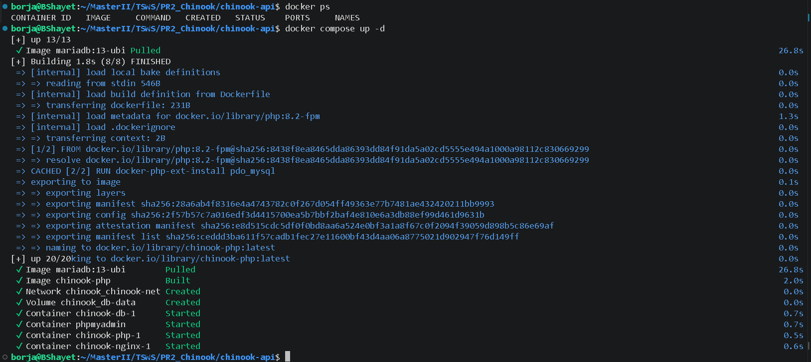
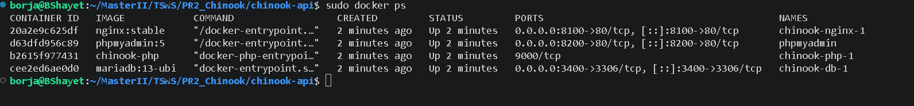
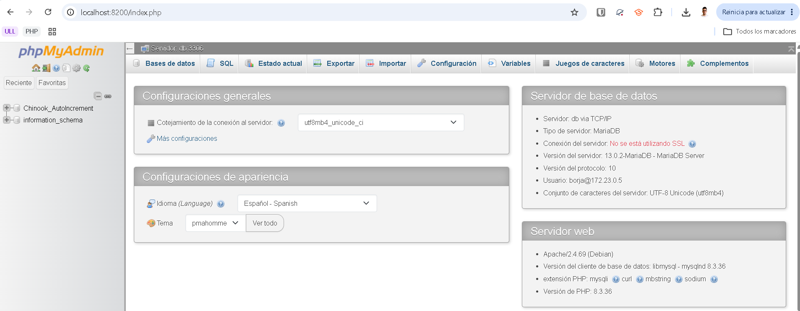
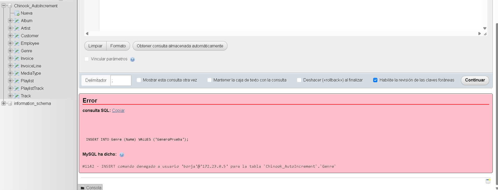
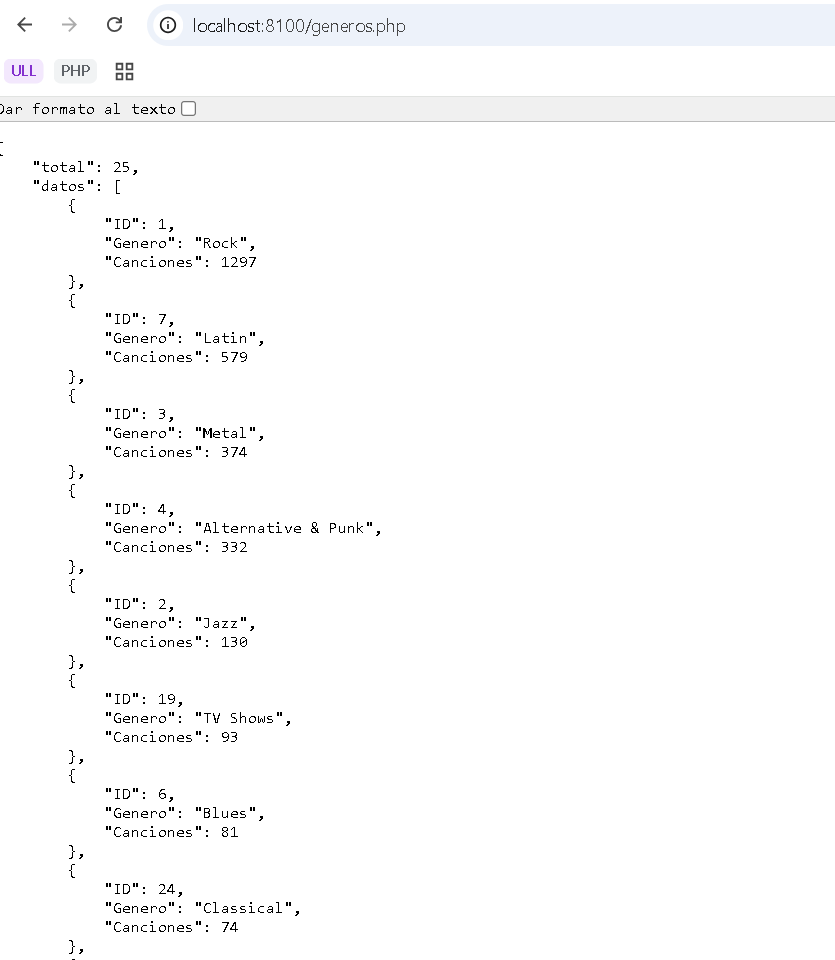
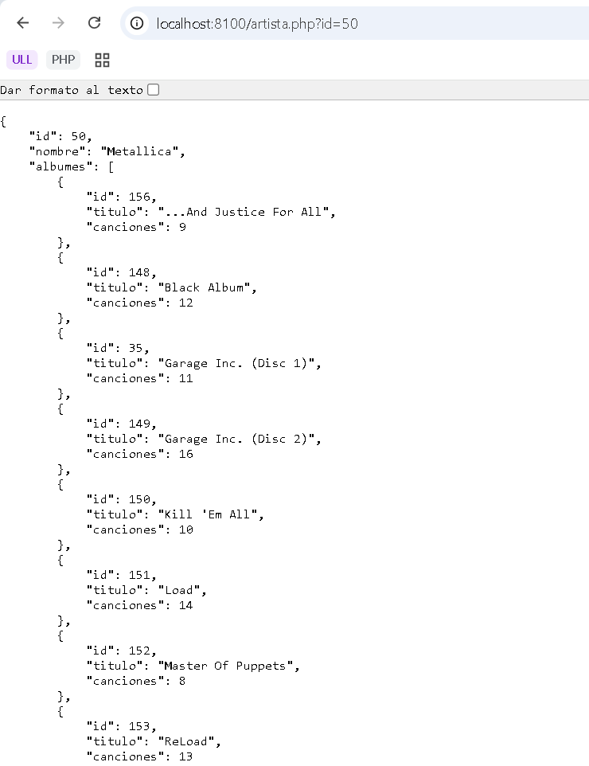
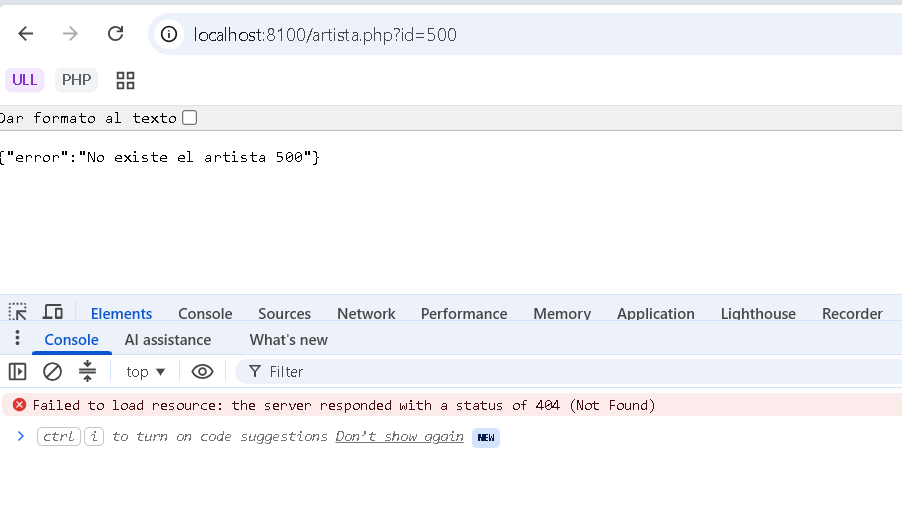
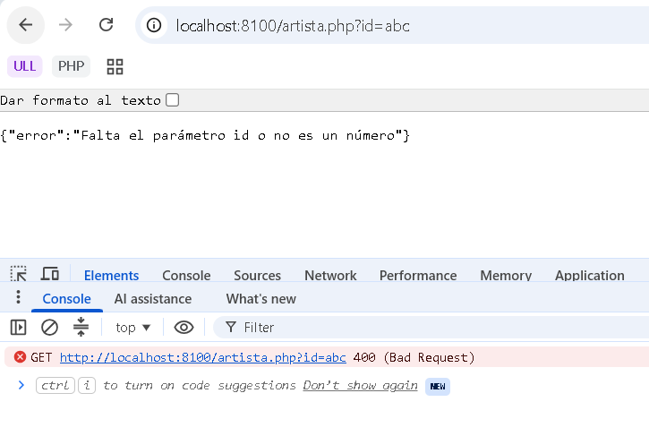
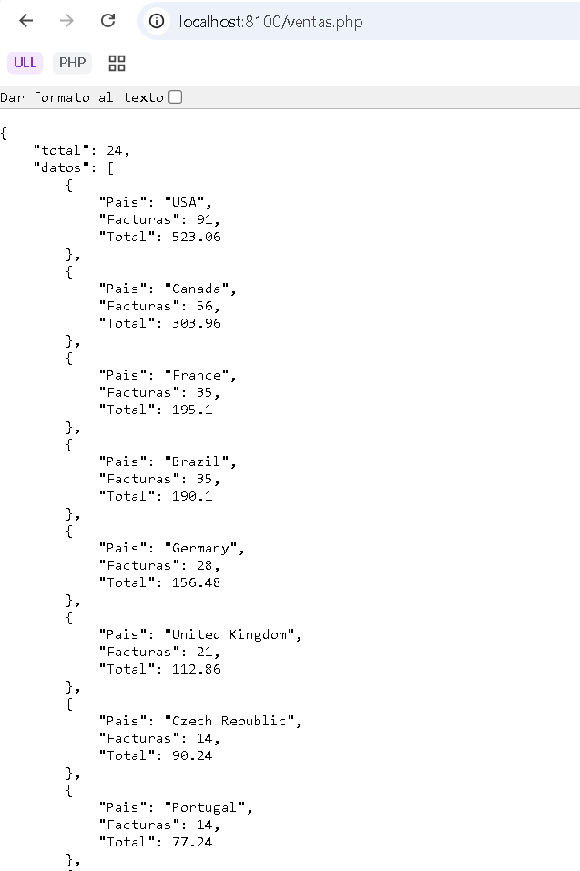

# Chinook API — Docker Compose

**Autor:** Borja Medina Ramos  
**Usuario de base de datos:** `borja`  
**Base de datos:** `Chinook_AutoIncrement`

Este proyecto consiste en desplegar una API sobre la base de datos Chinook mediante Docker Compose, utilizando MariaDB, PHP-FPM y Nginx. También se utiliza phpMyAdmin para consultar la base de datos y HeidiSQL para comprobar la conexión y los permisos del usuario.

## 1. Puertos y usuarios

| Servicio | Puerto del equipo | Puerto del contenedor |
|---|---:|---:|
| Web (Nginx) | `8100` | `80` |
| Base de datos (MariaDB) | `3400` | `3306` |
| phpMyAdmin | `8200` | `80` |
| PHP-FPM | No publicado | `9000` |

Con respecto al usuario, debemos crear uno con nuestro nombre y permisos de lectura. La API solo necesita consultar los datos.

## 2. Infraestructura del proyecto

Podemos observar una estructura modular, donde cada componente tiene su propia ubicación:

```text
chinook-api/
├── .env
├── .env.example
├── compose.yaml
├── README.md
├── php/
│   └── Dockerfile
├── nginx/
│   └── default.conf
├── db/
│   ├── chinook.sql
│   └── 02-init.sql
├── web/
│   ├── generos.php
│   ├── artista.php
│   └── ventas.php
└── capturas/
```

### 2.1. Creación del fichero de configuración de variables de entorno

Para establecer una capa de seguridad, se utiliza el siguiente flujo:

1. Creamos el fichero `.env` con las credenciales, claves y otras variables de carácter sensible.
2. Añadimos el fichero `.env` a nuestro fichero de control del proyecto, por ejemplo, `.gitignore`.
3. Empleamos las variables del fichero `.env` en nuestro proyecto en tiempo de ejecución.

En sistemas modernos y escalables utilizamos servicios nativos en la nube o contenedores que ofrecen dicho servicio, como HashiCorp Vault o gestores de secretos, entre otros. También existen los **Docker Secrets**.

Para preparar el fichero de variables a partir del ejemplo:

```bash
cp .env.example .env
```

Debemos completar los valores correspondientes en `.env`, sin publicar las contraseñas en el repositorio.

### 2.2. Configuración de la base de datos

El gestor de la base de datos es MariaDB. Las variables de entorno utilizadas para su configuración son:

```dotenv
MARIADB_ROOT_PASSWORD=...
MARIADB_USER=...
MARIADB_PASSWORD=...
MARIADB_DATABASE=Chinook_AutoIncrement
```

Esta será la base de datos que utilizaremos en la práctica.

Tras el análisis de las versiones del contenedor MariaDB, se ha decidido utilizar la etiqueta `11.8`.

**Sintaxis del servicio en Docker Compose:**

```yaml
db:
  image: mariadb:11.8
  restart: unless-stopped
  ports:
    - "3400:3306"
  networks:
    - chinook-net
  volumes:
    - db-data:/var/lib/mysql
    - ./db:/docker-entrypoint-initdb.d:ro
  environment:
    MARIADB_ROOT_PASSWORD: ${MARIADB_ROOT_PASSWORD}
    MARIADB_DATABASE: Chinook_AutoIncrement
```

Los scripts incluidos en `/docker-entrypoint-initdb.d/` se ejecutan siguiendo un orden alfabético. Por lo tanto, hemos decidido añadir los permisos de usuario en un fichero `02-init.sql`. Nos aseguramos así de que este se ejecute tras la creación de la base de datos `Chinook_AutoIncrement`.

Al necesitar únicamente permisos de lectura, creamos un script SQL para proporcionar dicho permiso:

```sql
GRANT SELECT ON Chinook_AutoIncrement.* TO 'borja'@'%';
```

El usuario debe crearse previamente en el script de inicialización. No debemos asignarle permisos de escritura mediante otra configuración.

### 2.3. Descarga de la base de datos

Para descargar la base de datos, utilizamos el siguiente comando:

```bash
mkdir -p db
curl -L -o db/chinook.sql https://github.com/lerocha/chinook-database/releases/download/v1.4.5/Chinook_MySql_AutoIncrementPKs.sql
```

El fichero se guarda en la ubicación indicada y se utiliza para inicializar la base de datos.

### 2.4. Servicio PHP con PDO

**PHP Data Objects**, o PDO, es una extensión propia de PHP que sirve como interfaz ligera y consistente para el acceso y la consulta de datos en bases de datos. Es independiente del gestor de base de datos.

Para atender la alta demanda de solicitudes por parte de los usuarios, se integra una alternativa a PHP FastCGI para procesar código PHP mediante **PHP-FPM**, que puede considerarse un gestor de procesos.

Creamos un `Dockerfile` que nos despliegue PHP-FPM:

```dockerfile
FROM php:8.5-fpm
RUN docker-php-ext-install pdo_mysql
```

En este contenedor instalamos la extensión PDO para MySQL:

```bash
docker-php-ext-install pdo_mysql
```

Este contenedor será el que procese el código PHP que reciba en las solicitudes. Por ello, debe disponer de las variables de entorno que utilizaremos posteriormente con el método `getenv()`:

```dotenv
DB_HOST=...
DB_NAME=...
DB_USER=...
DB_PASS=...
```

### 2.5. Instalación del contenedor Nginx

Seguimos la misma lógica que con el contenedor PHP. En este caso, creamos una copia del fichero `default.conf` hacia el contenedor, pero **solo de lectura**.

**Volúmenes:**

```yaml
volumes:
  - ./nginx/default.conf:/etc/nginx/conf.d/default.conf:ro
  - ./web:/var/www/html:ro
```

En el fichero `default.conf` establecemos la configuración interna del contenedor y el envío de las peticiones PHP hacia PHP-FPM.

**FastCGI:** el servidor recibe una petición HTTP por parte de un cliente. En lugar de ejecutarla por sí mismo, la envía a un proceso que ejecuta el código y devuelve el resultado. FastCGI permite mantener un conjunto de procesos operativos (*process pool*) que esperan la llegada de nuevas solicitudes para procesarlas.

## 3. Despliegue desde cero

Clonamos el repositorio y accedemos a su directorio:

```bash
cd chinook-api
```

Descargamos `chinook.sql` con el comando del apartado 2.3, creamos el fichero `.env` a partir de `.env.example` y configuramos las credenciales.

Construimos y levantamos los contenedores:

```bash
docker compose up -d --build
```



Comprobamos que los servicios están en ejecución:

```bash
docker compose ps
```

**Captura de `docker compose ps`:**



## 4. Comprobación con phpMyAdmin

Accedemos a phpMyAdmin desde el navegador mediante la siguiente dirección:

URL: [http://localhost:8200](http://localhost:8200)

El servicio phpMyAdmin se conecta a MariaDB a través de la red interna de Docker, utilizando el nombre del servicio `db` y el puerto `3306`.

| Parámetro                 | Valor                          |
| ------------------------- | ------------------------------ |
| Dirección de acceso       | `http://localhost:8200`        |
| Servidor de base de datos | `db`                           |
| Puerto de MariaDB         | `3306`                         |
| Usuario                   | `borja`                        |
| Contraseña                | La configurada para el usuario |
| Base de datos             | `Chinook_AutoIncrement`        |

Si hemos configurado las variables `PMA_USER` y `PMA_PASSWORD` en el servicio de phpMyAdmin, podremos acceder directamente sin introducir las credenciales.

Captura de phpMyAdmin conectado a MariaDB:





### Comprobación de los permisos de lectura

Desde la pestaña SQL de phpMyAdmin, intentamos insertar un registro para comprobar que el usuario no tiene permisos de escritura:


INSERT INTO Genre (Name) VALUES ('GeneroPrueba');


MariaDB debe devolver el error 1142 por falta de permisos para realizar la operación.

Captura del error 1142 en phpMyAdmin:




## 5. Comprobación de los endpoints

### 5.1. Géneros

**URL:** http://localhost:8100/generos.php

Devuelve los géneros musicales con el número de canciones de cada uno, ordenados de mayor a menor cantidad.



### 5.2. Artista

**URL:** http://localhost:8100/artista.php?id=50

Devuelve el identificador y el nombre del artista, junto con sus álbumes ordenados por título y el número de canciones de cada álbum. 



Si falta el identificador o no es válido, devuelve HTTP `400`; si el artista no existe, devuelve HTTP `404`:





### 5.3. Ventas

**URL:** http://localhost:8100/ventas.php

Devuelve las ventas agrupadas por país, con el número de facturas y el importe total, ordenadas de mayor a menor importe. También se puede utilizar el filtro `?pais=USA`.




## 6. Inspección de la red Docker

Ejecutamos el siguiente comando:

```bash
docker network inspect chinook_chinook-net
```

**Salida del comando (pendiente de incorporar la salida real):**

```json
[
    {
        "Name": "chinook_chinook-net",
        "Id": "07752badd0181a5cf76dca67a0364177fd29e44f0ff7c16f20bd8ecd90d57197",
        "Created": "2026-11-09T09:56:20.030181702Z",
        "Scope": "local",
        "Driver": "bridge",
        "EnableIPv4": true,
        "EnableIPv6": false,
        "IPAM": {
            "Driver": "default",
            "Options": null,
            "Config": [
                {
                    "Subnet": "172.23.0.0/16",
                    "IPRange": "",
                    "Gateway": "172.23.0.1"
                }
            ]
        },
        "Internal": false,
        "Attachable": false,
        "Ingress": false,
        "ConfigFrom": {
            "Network": ""
        },
        "ConfigOnly": false,
        "Options": {},
        "Labels": {
            "com.docker.compose.config-hash": "f6fdfa9c8a983fbc41249bc7b7ddbf51247f79d344a6680e50f94df88532aa7f",
            "com.docker.compose.network": "chinook-net",
            "com.docker.compose.project": "chinook",
            "com.docker.compose.version": "5.5.1"
        },
        "Containers": {
            "1312b4930f9800d29405da2f270dddd2de309d5985eec541af44541c369201a5": {
                "Name": "chinook-db-1",
                "EndpointID": "3aaa5225c093a69bfec2fad806ccdd2337c80ee3e65571653863977f7a4b1f2c",
                "MacAddress": "06:72:62:0b:6a:7a",
                "IPv4Address": "172.23.0.2/16",
                "IPv6Address": ""
            },
            "58e5e301f36ef3aac07d2ca596103bdce268eacf9d135e28ea66167bad651b8d": {
                "Name": "chinook-nginx-1",
                "EndpointID": "2c3a51b1fa68e58a09295ffdbc107a78b3759499244769fabc2655bf968ab339",
                "MacAddress": "06:7e:e5:6b:3a:e2",
                "IPv4Address": "172.23.0.5/16",
                "IPv6Address": ""
            },
            "6733f4b2f4cbbc8b1f671040f418bf714f8fe70a6099bed667596368260e4f8b": {
                "Name": "chinook-php-1",
                "EndpointID": "b6a5e00ac2e946767969fe184c53656b09cbee7d8fe61772b949944374e1f2e6",
                "MacAddress": "b2:00:58:ab:03:44",
                "IPv4Address": "172.23.0.4/16",
                "IPv6Address": ""
            },
            "90a90c7d1511ebe02a0d5bfccdccd64e955427466fd9711c4b1bb9fbc9dd7d8f": {
                "Name": "chinook-phpmyadmin-1",
                "EndpointID": "b49e6ad024da6c4d21fa0e2b483966e7842c8f1343cce1046d2f00584bf1c85a",
                "MacAddress": "42:34:61:21:96:9c",
                "IPv4Address": "172.23.0.3/16",
                "IPv6Address": ""
            }
        },
        "Status": {
            "IPAM": {
                "Subnets": {
                    "172.23.0.0/16": {
                        "IPsInUse": 7,
                        "DynamicIPsAvailable": 65529
                    }
                }
            }
        }
    }
]
```

**Direcciones IP de los contenedores (completar con los valores reales):**

- `db`: `172.23.0.2/16`
- `php`: `172.23.0.4/16`
- `nginx`: `172.23.0.5/16`
- `phpmyadmin`: `172.23.0.3/16`

Si la red tiene otro nombre, podemos comprobarlo mediante `docker network ls` y utilizar el nombre real en la inspección.

## 7. Cuestiones teóricas

### 7.1. ¿Por qué HeidiSQL se conecta al puerto 3400 y PHP al 3306? ¿Y por qué PHP usa `db` como host y no `localhost`?

HeidiSQL se ejecuta en nuestro ordenador y accede a MariaDB mediante el puerto `3400`, publicado por Docker. PHP se comunica con la base de datos dentro de la red Docker, utilizando el puerto interno `3306` y el nombre del servicio `db`, ya que `localhost` se referiría al propio contenedor PHP.

### 7.2. El servicio `php` no publica ningún puerto. ¿Cómo le llegan entonces las peticiones?

Las peticiones llegan primero a Nginx, que tiene publicado el puerto `8100`. Cuando se solicita un fichero PHP, Nginx envía la petición a PHP-FPM a través de la red interna de Docker, utilizando el puerto `9000`, sin necesidad de publicarlo en el ordenador.

### 7.3. Si añades un script nuevo en `db/` con el proyecto ya creado, ¿se ejecuta? ¿Qué tienes que hacer y qué pierdes al hacerlo?

No, los scripts de inicialización de MariaDB solo se ejecutan cuando el directorio de datos está vacío. Para volver a ejecutarlos, debemos eliminar los volúmenes con `docker compose down -v` y levantar el proyecto de nuevo, perdiendo los datos almacenados anteriormente en esos volúmenes.

### 7.4. En el error 1142 aparece tu usuario con una IP (`'borja'@'172.…'`). ¿De quién es esa IP y por qué no es la de tu PC?

La dirección IP identifica el origen de la conexión tal como lo ve MariaDB dentro de la red de Docker. No tiene por qué coincidir con la IP de nuestro ordenador, porque Docker utiliza redes virtuales y puede traducir las direcciones de las conexiones entrantes. Esta concretamente corresponde con la dirección IP interna del contenedor de phpmyadmin dentro de la red virtual chinook_chinook-api.

## 8. Detención de los servicios

Para detener los contenedores sin eliminar los datos:

```bash
docker compose down
```

Para detenerlos y eliminar también los volúmenes:

```bash
docker compose down -v
```

La segunda opción elimina los datos persistentes, por lo que los scripts de inicialización se ejecutarán nuevamente al levantar el proyecto.
