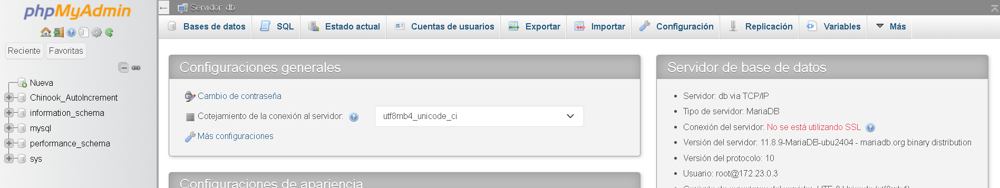
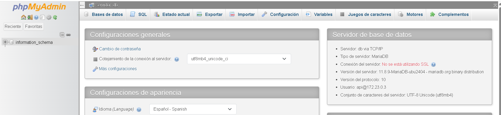
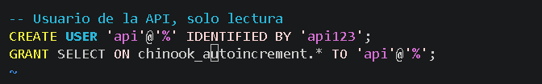
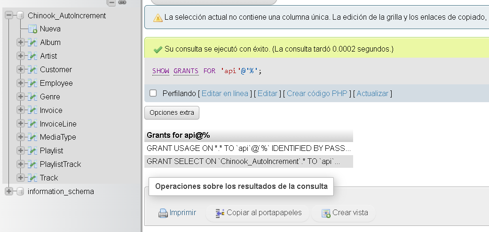
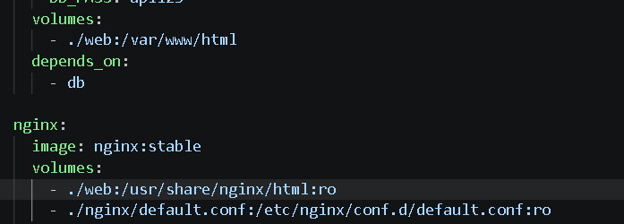
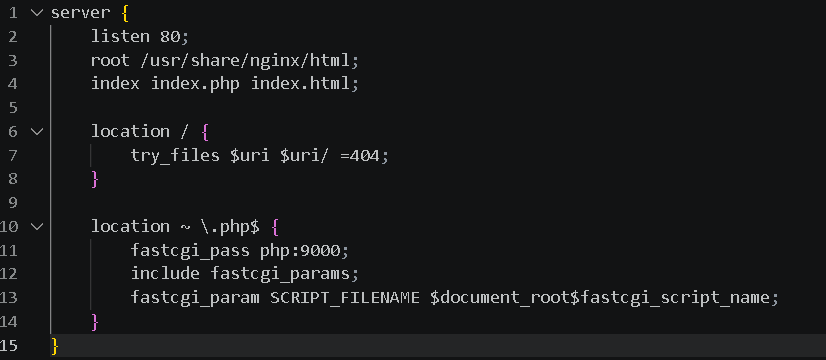
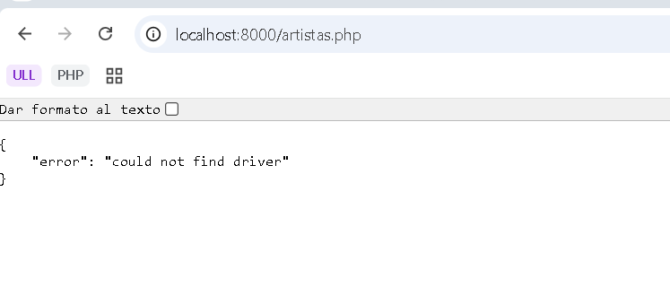
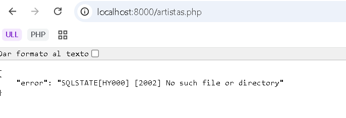
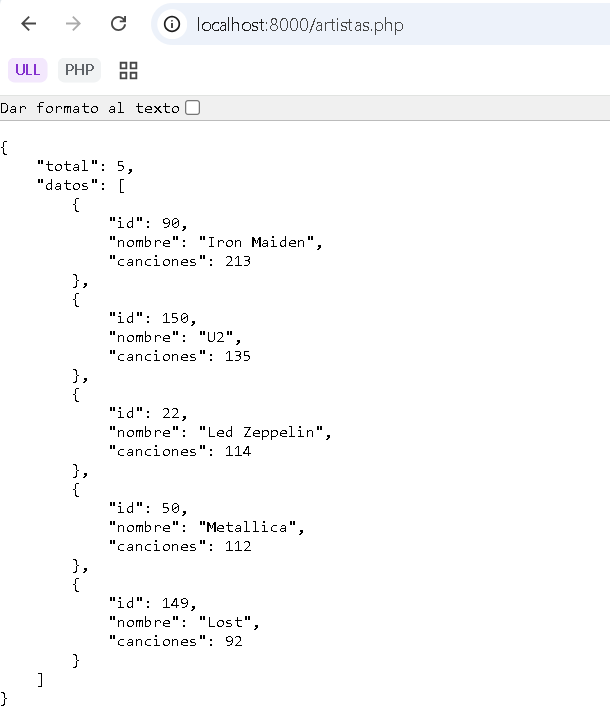

# chinook-roto

Este proyecto **no funciona**. Tiene varios errores repartidos entre `compose.yaml`, los Dockerfile, la configuración de Nginx y los scripts de la base de datos. Encuéntralos y arréglalos.

Antes de empezar, para tu propio proyecto (`docker compose down` en su carpeta) para que no haya conflictos.

## Cuándo está arreglado

1. `http://localhost:8000/artistas.php` devuelve un JSON con los 5 artistas con más canciones. El primero es Iron Maiden, con 213.
2. HeidiSQL se conecta a `127.0.0.1`, puerto `3307`, con el usuario `api` y la contraseña `api123`, y ve la base de datos `Chinook_AutoIncrement`.
3. phpMyAdmin (`http://localhost:8081`) entra con ese mismo usuario.

## Reglas

- No cambies `web/artistas.php` ni `web/conexion.php`: el código PHP está bien.
- Apunta cada error que encuentres: **qué síntoma veías, con qué comando lo descubriste y qué cambiaste**. Esa lista es lo que se corrige.
- Puedes usar los apuntes. Te harán falta `docker compose logs`, `docker compose ps` y `docker compose exec`.

## Errores y Soluciones


### ERROR DE PERMISOS DE API EN CHINOOK_AUTOINCREMENT

El primer error que se encuentra es que el usuario no tiene acceso a la base de datos de Chinook_AutoIncrement.

Accedemos a la página web de phpmyadmin a través del puerto 8081: http://localhost:8081 e introducimos las credenciales de root.
En la siguiente imagen podemos observar que desde el lado de root se ha creado la base de datos de Chinook_AutoIncrement



Posteriormente accedemos con el usuario api y vemos que dicha base de datos no existe, esto es un indicio de que el usuario no tiene acceso a la misma.



Lo importante es acceder al fichero de configuración de permisos: vim ./db/usuario.sql



Observamos que al proporcionar los permisos de lectura con GRANT faltan las mayúsculas en el nombre de la base de datos. 
Lo cambiamos por: GRANT SELECT ON Chinook_AutoIncrement.* TO 'api'@'%';

Reiniciamos los volumenes y volvemos a poner en marcha todos los contenedores:
```bash
docker compose down -v
docker compose up -d
```
Tras la corrección de este fallo, ya podremos observar que el usuario api ya tiene acceso a la base de datos:



### ERROR EN COMUNICACIÓN CON EL CONTENEDOR PHP-FPM

Otro error localizado es en el servicio nginx. En su configuración inicial default.conf indica un servicio que procesará las solicitudes
de los usuario y enviará el código a otro contenedor (PHP-FPM) que atiende las peticiones recibidas a través del puerto 9000. Aquí podemos realizar dos operaciones claves. O exponemos el puerto 9000 en el servicio php tanto interna como externamente o creamos una red interna virtual que permitiría intercomunicar estos servicios aislándolo de accesos externos.

Por simplicidad y corrección de errores, haremos un caso sencillo de exponer el puerto 9000 sobre el servicio php.
Para ello, en compose.yaml agregamos en el servicio php la siguiente fila:

```yml
ports:
  - 9000:9000
```

Tras esta corrección, nginx enviará las solicitudes HTTP para ser procesadas por el contenedor php ya que ahora sí hay un medio para la comunicación entre sí. Volvemos a reiniciar los servicios:

```bash
docker compose down -v
docker compose up -d
```

### ERROR EN LA RUTA DE FICHEROS

Otro error localizado es en la ruta de búsqueda de los ficheros .php. 



Vemos que el mapeo de los ficheros php no siguen una ruta fija. Por lo tanto, nginx solicita el procesamiento de los ficheros en una ruta que el contenedor PHP desconoce pues, previamente, se le ha indicado otra ruta.

Para corregir esto deberemos estandarizar la ruta de los ficheros. En nuestro caso modificamos tanto en el compose.yaml como en el fichero default.conf



donde cambiaremos /usr/share/nginx/html por /var/www/html

Tras esto volveremos a reiniciar los servicios nuevamente.

### ERROR EN EL DRIVER

Este error se produce porque no encuentra el PDO que permite interactuar con diferentes sistemas de bases de datos. Si vemos en el fichero Dockerfile de php, no se ha descargado la extensión de php-fpm para poder manejar con dichos sistemas. Incluímos en ese fichero la siguiente línea que ejecutará y descargará el paquete correspondiente:



**RUN docker-php-ext-install pdo_mysql**

### ERROR NOMBRE DE HOST

En la siguiente imagen podemos ver que intenta acceder a un host, sin embargo, este dice que no se encuentra:



Esto sucede porque el conector PDO, no puede establecer una conexión. Este PDO es procesado por el contenedor php por lo tanto, posiblemente las variables de conexión sean incorrecta.

Concretamente la variable de entorno:
DB_HOST: localhost

Esta hace referencia al contenedor en sí mismo, y efectivamente, en el contenedor php no se encuentra la base de datos. Cambiaremos localhost por el nombre del servicio, en este caso db

Tras esta corrección, la página web muestra los artista como se indicaba en el enunciado:


